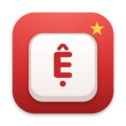

<p align="center"></p>

# Phím Việt

Tác giả: **Danh Phạm - 0356719463**

Bộ gõ tiếng Việt cho macOS, viết bằng **InputMethodKit** (chuẩn input method của Apple) với lõi xử lý bằng Rust.

- ✅ Hai cách dùng, chọn tuỳ ý (chi tiết ở mục [Hai chế độ](#hai-chế-độ-chọn-cái-nào)):
  - **Phím Việt** (input method chuẩn của Apple): **không** event tap, **không** phím giả, **không** cần quyền Trợ năng.
    App nào không cho kiểm chứng (Word, một số ô của Chrome) thì có gạch chân.
  - **Phím Việt Key** (app chạy riêng, giống OpenKey/EVKey/Gõ Nhanh): **không gạch chân ở mọi app**, cần quyền Trợ năng.
- ✅ Telex, VNI, Simple Telex · gõ dấu tự do (`tiengse` → `tiếng`) · đặt dấu kiểu mới (hoà) / cũ (hòa)
- ✅ Kiểm tra âm tiết · tự khôi phục từ tiếng Anh (`text`, `with`, `user`) · ESC trả lại phím thô
- ✅ Gõ không gạch chân **an toàn**: chỉ ghi thẳng khi app đã chứng minh đọc lại đúng, mọi lần sửa đều kiểm chứng trước — nghi ngờ thì bỏ từ, không bao giờ ghi đè
- ✅ Gõ tắt (giữ hoa/thường: `vn`/`Vn`/`VN`), chuyển Việt/Anh bằng ⌃⇧, nhớ theo từng app, biểu tượng V/E
- ✅ Riêng tư: không kết nối mạng, không thu thập dữ liệu, log không chứa nội dung gõ

Yêu cầu: macOS 13 Ventura trở lên (Apple Silicon hoặc Intel).

## Cài đặt từ file .dmg (không cần Xcode, Rust)

1. Tải `PhimViet-<phiên bản>.dmg` (mục **Releases** của repo, hoặc tự tạo bằng `make dmg`), mở file.
2. Bấm đúp **Cài đặt Phím Việt.command**. Nếu macOS chặn vì "nhà phát triển không xác định" (bản chưa ký bằng
   chứng chỉ Apple): mở Terminal, kéo file đó vào rồi nhấn Enter — hoặc System Settings → Privacy & Security →
   **Open Anyway**.
3. Chọn cách dùng (xem [Hai chế độ](#hai-chế-độ-chọn-cái-nào)): thêm **Phím Việt** trong Input Sources, hoặc mở
   **Phím Việt Key** (không gạch chân, cần quyền Trợ năng) và chọn bàn phím ABC.

Gỡ: bấm đúp **Gỡ cài đặt Phím Việt.command** trong file .dmg.

## Cài đặt từ mã nguồn

Cần [Rust](https://rustup.rs) và Xcode Command Line Tools (`xcode-select --install`). Không cần Xcode đầy đủ.

```bash
make install          # build + cài vào ~/Library/Input Methods + đăng ký input source
# hoặc: make install-select   (chọn luôn Phím Việt làm nguồn nhập hiện tại)
```

Sau đó: **System Settings → Keyboard → Text Input → Input Sources → Edit… → "+" → Vietnamese → Phím Việt → Add**.
Nếu chưa thấy Phím Việt trong danh sách: đăng xuất rồi đăng nhập lại.

## Sử dụng

| Việc | Cách |
|---|---|
| Chuyển Việt ⇄ Anh | Nhấn rồi nhả **⌃ Control + ⇧ Shift** (đổi trong Cài đặt) · hoặc menu nhập liệu · hoặc biểu tượng V/E |
| Lấy lại phím thô của từ đang gõ | **ESC** (`vieejt` → ESC → `vieejt`) |
| Sửa dấu từ vừa gõ xong | Xoá dấu cách bằng ⌫ rồi gõ dấu tiếp: `may ` ⌫ `as` → `mấy` (ở app đã gõ thẳng được) |
| Đổi kiểu gõ, kiểu đặt dấu, bật/tắt tính năng | Menu nhập liệu (biểu tượng ô **V** trên thanh menu) |
| Cài đặt chi tiết, gõ tắt, danh sách app | Menu nhập liệu → **Cài đặt…** |

### Telex

| Phím | Kết quả | Phím | Kết quả |
|---|---|---|---|
| `s f r x j` | sắc huyền hỏi ngã nặng | `z` | xoá dấu |
| `aa ee oo` | â ê ô | `aw ow uw` | ă ơ ư |
| `dd` | đ | `w` | ư |
| `uow` | ươ (`thuowng` → thương) | gõ đúp | huỷ: `aaa`→aa, `ass`→as, `ddd`→dd |

Gõ dấu ở đâu cũng được: `toans`, `toasn`, `tosan` đều ra `toán`; `tiengse` → `tiếng`.
Muốn `xoong`, `boong`: gõ `xooong`. Simple Telex: như Telex nhưng `w` đứng riêng không thành `ư`.

### VNI

`1` sắc · `2` huyền · `3` hỏi · `4` ngã · `5` nặng · `0` xoá dấu · `6` mũ (â ê ô) · `7` móc (ơ ư) · `8` trăng (ă) · `9` đ.
Ví dụ: `Vie65t Nam` → `Việt Nam`, `d9uo7ng2` → `đường`.

### Gõ không gạch chân

Mặc định **không** gạch chân (mục "Gạch chân chữ đang gõ" trong menu nhập liệu đang tắt). Ở mỗi ứng dụng, hai từ đầu tiên vẫn có gạch chân trong lúc Phím Việt kiểm chứng app đọc lại văn bản
và báo vị trí con trỏ chính xác; đạt thì các từ sau gõ thẳng (mỗi lần ghi vẫn được kiểm tra lại). App không đạt (một số terminal, ô nhập đặc biệt) tự động dùng chế độ
gạch chân — an toàn, không mất chữ. Chi tiết: [docs/ARCHITECTURE.md](docs/ARCHITECTURE.md).

## Hai chế độ: chọn cái nào?

| | **Phím Việt** (input method) | **Phím Việt Key** (app chạy riêng) |
|---|---|---|
| Cách hoạt động | Chuẩn InputMethodKit của Apple: chữ đang gõ là "marked text", hoặc ghi thẳng khi app chứng minh đọc lại đúng | Chặn phím toàn hệ thống, xoá chữ cũ bằng ⌫ rồi gõ chữ mới (cách của OpenKey, EVKey, Gõ Nhanh) |
| Gạch chân | Có ở app không kiểm chứng được (Word, một số ô Chrome) và 2 từ đầu mỗi app | **Không** ở mọi app |
| Quyền | Không cần | **Trợ năng (Accessibility)** |
| Rủi ro | Không bao giờ ghi đè chữ (nghi ngờ → bỏ từ) | Gõ quá nhanh / ô có gợi ý lạ có thể sai một từ (đã có xử lý riêng cho trình duyệt, Office, Electron) |
| Chọn trên thanh menu | **Phím Việt** | **ABC** (Phím Việt Key tự nghỉ khi đang chọn bộ gõ khác) |

Hai chế độ dùng **chung engine và cài đặt** (kiểu gõ, gõ tắt, danh sách app). Mở Phím Việt Key:
`make install-key`, hoặc menu nhập liệu Phím Việt → **Gõ không gạch chân ở mọi app (Phím Việt Key)…**.
Lần đầu: bật quyền ở **System Settings → Privacy & Security → Accessibility → Phím Việt Key**,
rồi chọn **ABC** trên thanh menu. Biểu tượng: `V`/`E` = đang gõ Việt/Anh · `V–` = đang nghỉ (đang chọn bộ gõ khác)
· `V!` = chưa có quyền. Mỗi lần build lại, macOS coi là app mới → cần bật lại quyền (`make install-key` tự xoá mục cũ).

## Build từ mã nguồn

```bash
make test        # cargo test (debug+release) + clippy + fmt + FFI từ C + test Swift
make build       # → build/PhimViet.app (universal arm64 + x86_64, ký ad-hoc)
make verify      # test + build + chứng minh không dùng event tap / phím giả / Accessibility
make bench       # thời gian xử lý trung bình mỗi phím
```

| Thư mục | Nội dung |
|---|---|
| `core/` | Lõi engine Rust (0 dependency) + test |
| `ffi/` | C ABI (`staticlib`), header `ffi/include/phimviet.h` |
| `macos/PhimViet/` | Input method: `InputController`, `Composition/` (presenter), `Shared/`, `Settings/` (giao diện) |
| `macos/PhimVietSettings/` | App Cài đặt (nằm trong `PhimViet.app/Contents/Helpers`) |
| `macos/PhimVietTests/` | Test Swift với client giả |
| `scripts/` | build, cài, gỡ, đăng ký input source, kiểm chứng |
| `docs/` | Kiến trúc, quyết định, quy tắc engine, kiểm thử thủ công, vấn đề đã biết |

Có Xcode đầy đủ? `brew install xcodegen && make xcode` sinh `macos/PhimViet.xcodeproj` (tuỳ chọn, xem `USE_XCODE=1` trong `scripts/build.sh`).

## Gỡ cài đặt

```bash
make uninstall                       # gỡ app + xoá cài đặt
scripts/uninstall.sh --keep-settings # gỡ nhưng giữ cài đặt, gõ tắt
```

## Xem log

```bash
log stream --predicate 'subsystem == "com.phimviet.inputmethod.PhimViet"'
```

Log chỉ có tên sự kiện (`trust.proved`, `direct.abandon`, `click.endword`, `mode V/E`…), **không** có nội dung gõ.
Chỉ khi tự build với cờ `-D PHIMVIET_DEBUG_TEXT` thì `Log.redact` mới trả nội dung (dùng khi gỡ lỗi).

## Ký Developer ID & notarize (tuỳ chọn, để phân phối)

Bản `make build` ký ad-hoc, chỉ dùng trên máy tự build. Để phát hành:

```bash
ID="Developer ID Application: Tên Bạn (TEAMID)"
codesign --force --options runtime --timestamp --sign "$ID" build/PhimViet.app/Contents/Helpers/PhimVietSettings.app
codesign --force --options runtime --timestamp --sign "$ID" build/PhimViet.app
ditto -c -k --keepParent build/PhimViet.app build/PhimViet.zip
xcrun notarytool submit build/PhimViet.zip --keychain-profile "notary" --wait
xcrun stapler staple build/PhimViet.app
```

(`notarytool` cần Xcode hoặc bản CLT có kèm; tạo profile bằng `xcrun notarytool store-credentials notary`.)

## Tài liệu

- [Kiến trúc](docs/ARCHITECTURE.md) · [Quy tắc engine](docs/ENGINE_RULES.md) · [Quyết định](docs/DECISIONS.md)
- [Kiểm thử thủ công](docs/MANUAL_TEST.md) · [Vấn đề đã biết](docs/KNOWN_ISSUES.md)

## Hướng phát triển (ngoài phạm vi v1)

- Bảng mã cũ (TCVN3, VNI-Windows) và công cụ chuyển mã
- Gợi ý từ / từ điển (giúp phân biệt từ tiếng Anh như `test`, `this`)
- Đồng bộ cài đặt qua đám mây
- Bản Windows / Linux / iOS
- Tự cập nhật (Sparkle)

## Tác giả & giấy phép

Tác giả: **Danh Phạm - 0356719463**. [Giấy phép MIT](LICENSE). Mã nguồn viết mới hoàn toàn (clean-room); không sao chép mã từ dự án GPL/AGPL.
