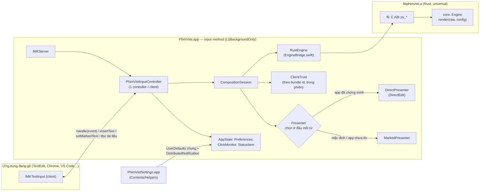
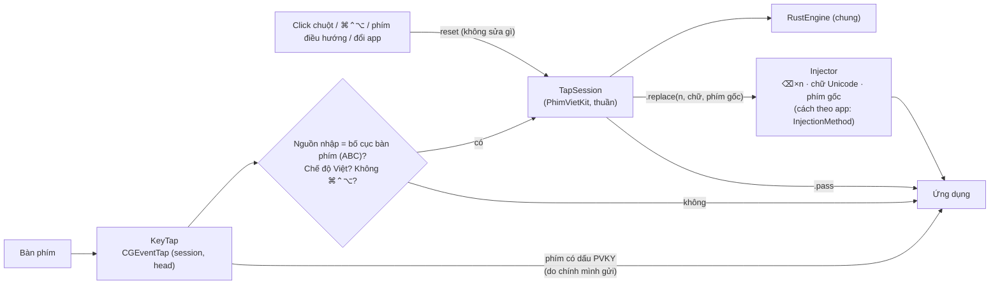
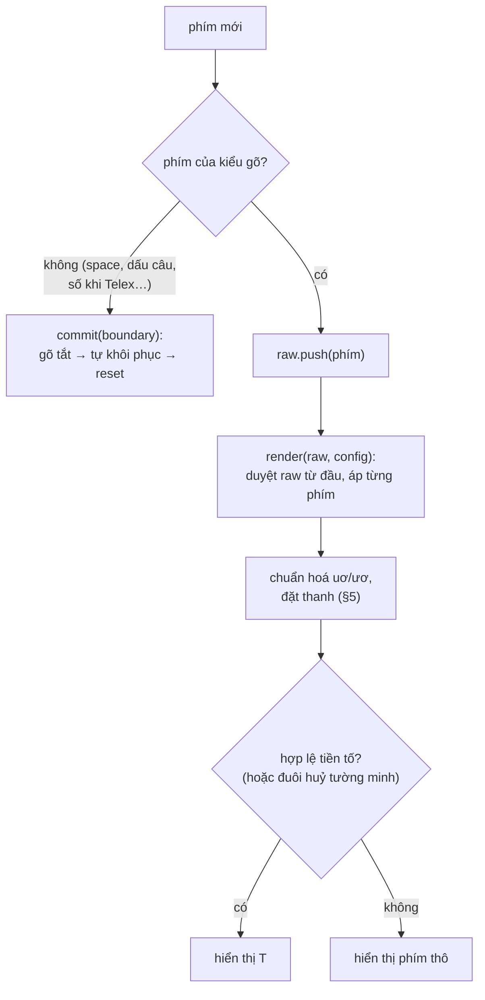
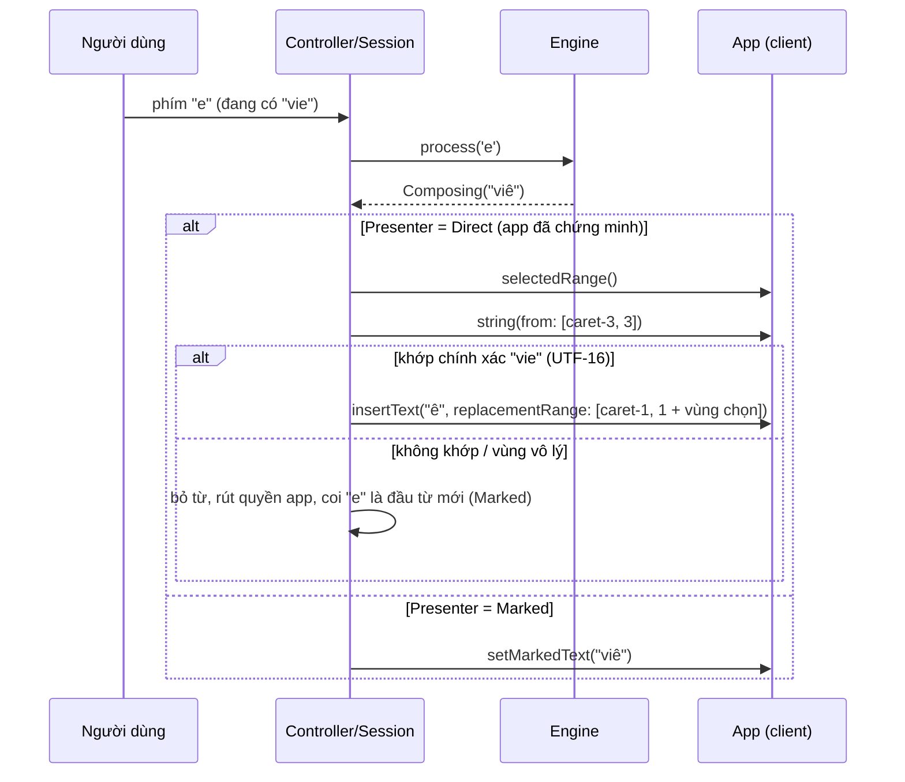

# Kiến trúc Phím Việt

## Tổng quan

| Thành phần | Vị trí | Vai trò |
|---|---|---|
| Lõi engine | `core/` | Toàn bộ logic tiếng Việt, thuần Rust, 0 dependency, không phụ thuộc OS |
| C ABI | `ffi/` | `staticlib` + header viết tay `ffi/include/phimviet.h`, `catch_unwind` mọi hàm |
| PhimVietKit | `macos/PhimViet/{Composition,Shared}`, `EngineBridge.swift` | Logic trình bày chữ + cài đặt, thuần Foundation, test được bằng client giả |
| Shell IMK | `macos/PhimViet/*.swift` | `IMKServer`, controller, menu, status item, click monitor |
| Cài đặt | `macos/PhimVietSettings`, `macos/PhimViet/Settings` | App SwiftUI riêng (xem DECISIONS D5) |
| Phím Việt Key | `macos/PhimVietKey`, `Composition/TapSession.swift` | App chạy riêng không gạch chân (event tap, cần quyền Trợ năng — D12) |

**Không có** event tap, phím Backspace giả, hay quyền Trợ năng trong input method và app Cài đặt —
`scripts/verify_no_eventtap.sh` kiểm chứng trên cả mã nguồn và file nhị phân. Ngoại lệ duy nhất là app chạy riêng bên dưới.

## Phím Việt Key — app chạy riêng (DECISIONS D12)

- `TapSession` chỉ nhớ `shown` — chữ chính nó đã đưa vào app cho từ hiện tại; không đọc tài liệu. Phím trùng đúng chữ
  engine muốn hiện → để app tự chèn (không gửi phím giả). Chỉ khi cần đổi chữ mới nuốt phím và gửi ⌫ + chữ mới.
- `InjectionMethod.forApp`: trình duyệt gõ trước U+202F để huỷ gợi ý bôi đen rồi ⌫ thêm 1; Office/Electron/terminal có
  độ trễ giữa các phím; app khác gửi liền.
- Nguồn nhập không phải bố cục bàn phím (Phím Việt bản IMK, Nhật, Trung…) → nghỉ hẳn, tránh gõ chồng.

## Engine: tính lại từ phím thô

- Trạng thái của engine chỉ gồm `raw: Vec<KeyInput>` + cấu hình. Mọi thứ khác (chữ cái, dấu phụ, thanh,
  phím bị vô hiệu sau khi huỷ) được tính lại mỗi phím → không có lớp lỗi "lệch trạng thái".
- `render` là hàm thuần: test xác nhận `render(raw)` luôn bằng chữ đang hiển thị sau mỗi phím
  (`core/tests/property.rs`).
- Thanh điệu là thuộc tính của âm tiết; vị trí đặt thanh chỉ tính khi xuất chuỗi → gõ thanh ở bất kỳ đâu.
- Kiểm tra âm tiết hai mức: **tiền tố** (đang gõ) và **đầy đủ** (khi chốt). Bảng vần ở `core/src/syllable.rs`.
- Backspace: bỏ 1 ký tự hiển thị, dựng raw chuẩn (`core/src/restore.rs`) và **kiểm tra** `render(raw') == chuỗi còn lại`;
  không khớp thì "đóng băng" phần còn lại.
- Chi phí: trung bình ~1,4 µs/phím (release, Apple Silicon); từ > 64 phím bị đóng băng để chặn O(n²).

Đặc tả hành vi đầy đủ: [ENGINE_RULES.md](ENGINE_RULES.md).

## FFI và bộ nhớ

- `pv_engine_new` / `pv_engine_free` quản lý một `Engine` trên heap; con trỏ mờ `PvEngine *`.
- Mọi `char *` trả về là UTF-8 do Rust cấp phát; Swift (`RustEngine.take`) giải phóng đúng một lần bằng
  `pv_string_free` trong `defer`.
- Mọi hàm bọc `catch_unwind`: panic → engine reset, trả `PV_UNCHANGED` → phím được đưa cho ứng dụng.
- Một engine cho mỗi controller (mỗi client), chỉ dùng trên luồng chính của IMK.

## Trình bày chữ: Marked vs Direct

- **Chọn presenter ở đầu mỗi từ**, giữ tới khi chốt. Direct chỉ khi: tắt "Gạch chân chữ đang gõ", client báo được
  vị trí con trỏ lúc activate, bundle id khác rỗng, và `ClientTrust` = đã tin.
- **Chứng minh**: app chưa biết luôn bắt đầu bằng Marked; mỗi lần chốt, con trỏ phải ở đúng cuối chữ vừa chèn
  (tính từ `markedRange`) và chữ đọc lại phải khớp chính xác. Cần hai lần đạt ở hai vị trí khác nhau.
  Một lần không kiểm chứng được khi Direct → mất quyền tới hết phiên.
- **Kiểm tra sau khi ghi**: con trỏ phải dịch đúng độ dài vừa ghi; sau khi thay, đọc lại cả từ. Sai → kết thúc từ, rút quyền.
- **Chỉ thêm đuôi** (trường hợp phổ biến nhất) → `insertText` tại con trỏ, không đọc tài liệu.
- **Không lưu vị trí tuyệt đối**: Monaco/Electron có thể dựng lại textarea giữa các phím; vùng từ luôn tính lại
  từ con trỏ hiện tại và độ dài `shown`.
- **Vùng chọn sau con trỏ** (gợi ý tự hoàn thành ở thanh URL, Spotlight, Excel) được phủ vào vùng thay thế.
- **Backspace** khi Direct: engine luôn bớt đúng 1 ký tự hiển thị → trả phím cho app tự xoá (giữ undo của app).
- **Click chuột**: `ClickMonitor` (global monitor chuột, không cần quyền) đếm click; đầu mỗi phím nếu số click đổi
  kể từ đầu từ thì kết thúc từ: Direct → quên (không sửa tài liệu), Marked → chốt chữ đang hiển thị.

## Chế độ Việt/Anh

- Phím tắt chỉ-modifier (mặc định ⌃⇧) phát hiện qua `flagsChanged` bằng `ModifierToggle`: nhấn đủ tổ hợp rồi nhả hết,
  không có phím thường xen giữa, không có modifier thừa.
- Nhớ theo bundle id (`appModes` trong UserDefaults), danh sách "luôn Anh"/"luôn Việt" ưu tiên hơn.

## Cài đặt

- Lưu một khối JSON `preferences` trong domain `com.phimviet.inputmethod.PhimViet`; khoá thiếu → mặc định.
- Input method đọc lại khi nhận `DistributedNotification`; đổi từ menu nhập liệu thì phát ngược lại cho app Cài đặt.
- `Preferences.engineConfigJSON()` → `pv_set_config`.

## Nhật ký

`os.Logger(subsystem: "com.phimviet.inputmethod.PhimViet")`, category `input` / `app`. Chỉ ghi tên sự kiện
(`direct.abandon`, `trust.proved`, `click.endword`…), không ghi nội dung gõ; `Log.redact` chỉ trả nội dung khi build
với `-D PHIMVIET_DEBUG_TEXT`.

## Test

| Lớp | Lệnh | Nội dung |
|---|---|---|
| Engine | `cargo test --workspace` (+ `--release`) | 16.714 âm tiết × 5 thứ tự phím × Telex/VNI/Simple/kiểu cũ, round-trip backspace, ≥300 ca khó, tiếng Anh, 100k dãy ngẫu nhiên |
| FFI | `make ffi-test` | gọi C ABI từ C trên arm64 + x86_64 |
| Shell | `scripts/swift_test.sh` | swift-testing: DirectEdit, CompositionSession, ClientTrust, ModifierToggle, Preferences với client giả xấu |
| Thủ công | [MANUAL_TEST.md](MANUAL_TEST.md) | checklist theo ứng dụng |
